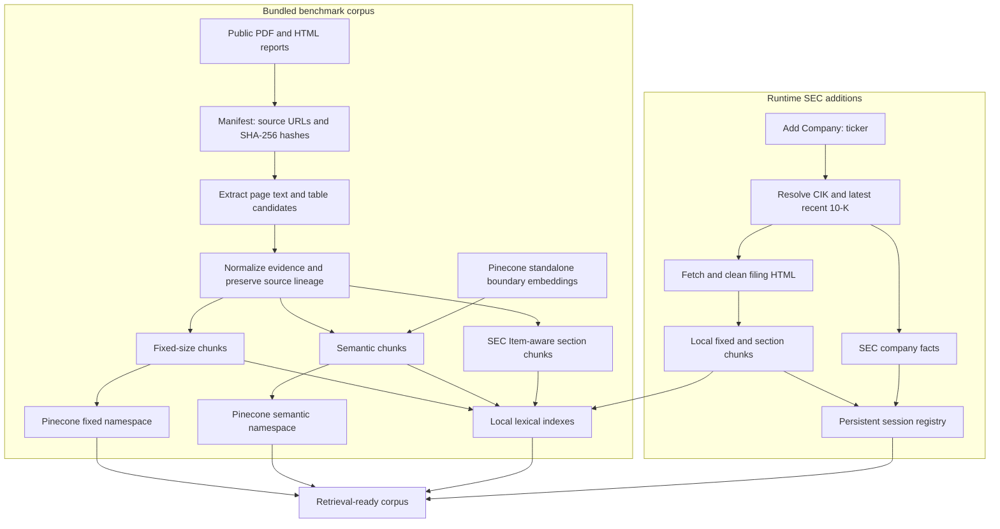
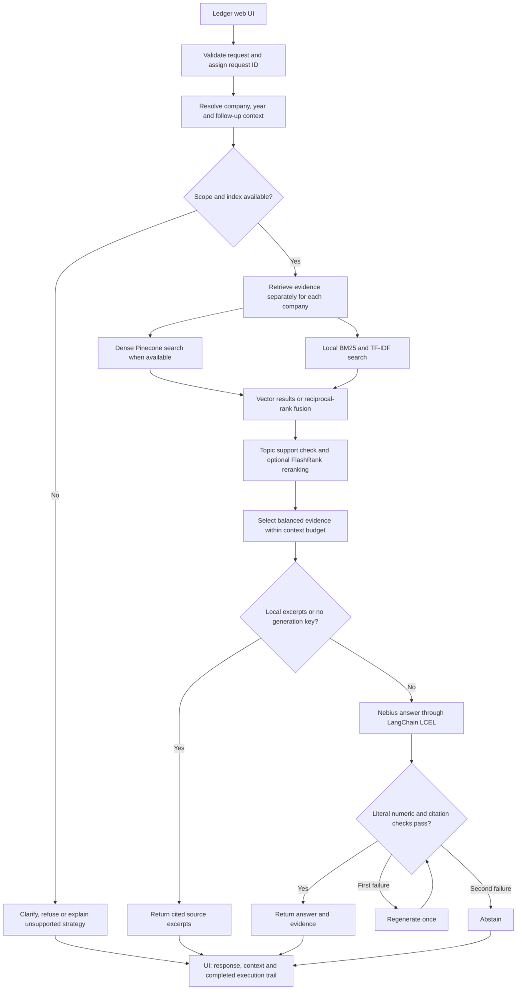

# Financial Document Intelligence Pipeline

A financial research workspace that answers questions across annual reports and earnings documents, with cited evidence, multiple chunking strategies, hybrid retrieval, and optional reranking.

The project has two complementary paths:

- **Interactive research:** a local web UI with company/year context, dynamic SEC ingestion, retrieval controls, and guarded Nebius generation.
- **Reproducible experiments:** a frozen bundled corpus for measuring chunking and reranking on the same development questions.

## Architecture

### Document ingestion and indexing



Pinecone automatically embeds the bundled fixed and semantic records using the same integrated retrieval model. The standalone model used to identify semantic boundaries is a separate operation.

**Runtime ingestion currently creates fixed and section chunks only. It does not automatically create semantic chunks or upload new filings to Pinecone.** The registry reports strategy availability per company and corpus.

### Question answering



LangGraph implements the **generation → verification → bounded regeneration/refusal** portion. Scope resolution and retrieval are Python orchestration around that graph, rather than a full LangGraph agent that independently plans its tools.

If retrieval returns no candidates, the workflow makes one bounded retry with an expanded query. If evidence remains insufficient, it abstains. Missing indexes are reported as an unsupported strategy before retrieval, rather than being presented as missing financial evidence.

### Components and responsibilities

| Component | Implementation | Responsibility |
|---|---|---|
| Web interface | HTML, CSS, JavaScript | Chat, Add Company, Chunk Lab, Evaluation, Market Context |
| HTTP and validation | `ui.py`, `workspace.py` | Local API, validated settings, cached chunk summaries, request IDs |
| Corpus registry | `registry.py` | Bundled/session separation, company aliases, strategy availability, atomic persistence |
| Extraction and normalization | `extract.py`, `tables.py` | PDF/HTML evidence, table candidates, document/page/block provenance |
| Chunking | `reference_chunk.py`, `section_chunk.py` | Fixed, embedding-based semantic, and heuristic SEC Item-aware chunks |
| Retrieval | `retrieval.py`, `vector_store.py` | Pinecone dense search, local lexical vectors, BM25, reciprocal-rank fusion |
| Reranking and context | `pipeline.py` | Local FlashRank and token-budgeted evidence assembly |
| Interactive orchestration | `agent.py`, `workflow.py` | Scope/context, balanced comparisons, generation and numeric guard |
| Generation | Nebius through a LangChain OpenAI-compatible adapter | Cited answers using supplied evidence |
| Runtime ingestion | `ingestion.py` | SEC pacing, CIK lookup, latest recent 10-K, accession-aware refresh and progress |
| Candidate figures | `figures.py` | Annual-table candidates and SEC company-facts parsing; not verified headline answers |
| Optional market context | `market.py` | Delayed history, Yahoo/Stooq fallback, 15-minute cache |
| Diagnostics | `logging_config.py` | Structured rotating logs, stage timing, request/job correlation, redaction |
| Evaluation | `evaluate.py`, evaluation scripts | Saved answer metrics and separate local retrieval experiments |

Market observations are kept separate from filing evidence: they are **not** supplied to answer generation or used in the RAG evaluation.

## Models and chunking support

| Purpose | Current model or method |
|---|---|
| Semantic boundary embeddings | Pinecone standalone `llama-text-embed-v2` |
| Bundled retrieval embeddings | Pinecone integrated `text-embedding-3-small`, 1536 dimensions, cosine |
| Generation | Nebius `google/gemma-3-27b-it` |
| Reranking | Local FlashRank `ms-marco-MiniLM-L-12-v2` |
| Local vector fallback | TF-IDF lexical vectors; **not** pretrained semantic embeddings |
| Answer evaluation judge | Nebius Gemma through RAGAS |

A separate OpenAI API key is not required for the configured Pinecone/Nebius path. The integrated OpenAI embedding model is invoked through Pinecone; it is not used as a standalone boundary-embedding endpoint.

| Corpus | Fixed-size | Semantic | SEC Item / section-aware | Dense Pinecone indexing |
|---|---|---|---|---|
| Bundled documents | Available | Available | Available after section build | Fixed and semantic |
| Newly added SEC filing, such as Tesla | Available | Not generated automatically | Available | Not uploaded automatically |

For a company without semantic chunks, the UI disables that option when its corpus is selected. API requests for unavailable strategies return an explanation and supported alternatives; the UI offers retry buttons. A company mentioned while searching the broader active corpus is checked in the same way.

### Chunk profiles

- **Bundled fixed:** LangChain recursive splitting, 512 characters with 64-character overlap.
- **Bundled semantic:** LangChain SemanticChunker, 65th-percentile boundary threshold, capped at 8,000 characters. Whitespace normalization can make offsets nonexact; block/page lineage is retained.
- **Section-aware:** heuristic SEC Item heading recognition and paragraph packing, targeting 4,000 characters without crossing recognized section boundaries.
- **Runtime fixed:** 2,000-character windows with a 1,800-character stride. This differs from the bundled experiment profile.

Chunk size and overlap are experimental confounds. A runtime fixed-versus-section comparison is not the same experiment as the saved bundled fixed-versus-semantic benchmark. Long passages may also be truncated by FlashRank's 512-token input limit.

## Corpus and provenance

The frozen bundled manifest contains **13 documents across JPMorgan Chase, Apple, Alphabet/Google, and Microsoft**, including annual reports and earnings releases. Fiscal periods differ by company. It is a reproducible snapshot, not an exhaustive or continuously updated collection of all recent filings.

See [data/manifest.json](data/manifest.json) for the exact document list, source URLs, fiscal periods, and hashes. Source downloads can become unavailable; the downloader uses those explicit URLs rather than discovering replacements silently.

Runtime SEC additions live separately under `data/session/`. The active corpus includes registered additions; the bundled corpus remains available for isolated experiments. Tesla is an example of an added company, not a member of the frozen four-company benchmark.

PDF/HTML extraction retains source identifiers and locations. Table normalization is conservative: separate unverified table candidates are excluded from reference chunking, while the original page text can still contain table text. Source preservation does not establish that every extracted column or generated interpretation is correct.

## Setup

Use Python 3.12. Node.js is only needed for the optional JavaScript syntax check; there is no frontend build step.

```bash
python3.12 -m venv .venv
.venv/bin/python -m pip install -r requirements-pipeline.txt -r requirements-dev.txt
```

[requirements-lock.txt](requirements-lock.txt) records resolved versions from the development environment. Copy `.env.example` to `.env` **only if `.env` does not already exist**, then fill in the required settings locally.

| Setting | Required for |
|---|---|
| `PINECONE_API_KEY`, `PINECONE_INDEX_HOST` | Hosted dense retrieval, uploads, and Pinecone boundary embeddings |
| `NEBIUS_API_KEY` | Generated answers and the configured RAGAS judge |
| `SEC_USER_AGENT` | Live SEC ingestion; use your real name and contact email |
| `LOG_LEVEL`, `LOG_DIR` | Optional local diagnostics configuration |

The main configuration is:

```dotenv
PINECONE_API_KEY=
PINECONE_INDEX_HOST=
PINECONE_API_MODE=documents
PINECONE_TEXT_FIELD=chunk_text
PINECONE_EMBEDDING_MODEL=text-embedding-3-small
PINECONE_NAMESPACE_PREFIX=financial-rag-reference-v1
SEMANTIC_EMBEDDING_PROVIDER=pinecone
SEMANTIC_EMBEDDING_MODEL=llama-text-embed-v2
CHUNK_DIR=data/chunks/reference

NEBIUS_API_KEY=
NEBIUS_BASE_URL=https://api.tokenfactory.nebius.com/v1
NEBIUS_MODEL=google/gemma-3-27b-it
RAGAS_JUDGE_PROVIDER=nebius

# Replace with your real contact identity for SEC access.
SEC_USER_AGENT=
LOG_LEVEL=INFO
LOG_DIR=logs
```

Create a Pinecone document index with a `chunk_text` string field configured for integrated `text-embedding-3-small` embeddings (1536 dimensions, cosine). Copy the index host from its details into `.env`. The `title` full-text field can remain.

Shell environment variables take precedence over `.env`. Keep credentials local and out of source control. Hosted embedding, generation, and evaluation calls incur service usage. Initial reranker weights and some tokenizer resources may require network access.

## Start the research UI

Run from the project directory:

```bash
.venv/bin/python -m financial_rag.ui
```

Open **http://127.0.0.1:8501**. Use `--port 8502` if needed. The server binds to loopback and loads `.env` at startup; restart it after changing service settings.

| View | What it provides |
|---|---|
| Ask documents | Corpus/chunking/retrieval controls, reranking, context, cited responses and source search |
| Add Company | SEC ticker ingestion, progress, recent jobs and refresh/already-current status |
| Chunk Lab | Bundled chunk counts, lengths and source samples |
| Evaluation | Saved Pinecone answer benchmark and separate local lexical retrieval results |
| Market Context | Optional delayed history, provider/as-of labels, chart and observations table |

### Ask a question

1. Choose a corpus. For a newly added company, start with **Fixed-size** or **SEC Item / section-aware**.
2. Ask a question with a company and fiscal year, or select the company in Corpus.
3. Inspect the answer status, backend label, original source, fiscal columns and units.

Examples:

- `What was JPMorgan Chase net income in 2024?`
- `Compare Apple and Microsoft revenue in 2025.`
- With Tesla selected: `What was operating cash flow in 2025?`
- Follow up with `And last year?`

Common forms such as `cashflow`, `cash-flow`, `EPS`, `capex`, and `opex` are normalized before scope checks and retrieval. If the app asks which company, replying with its name can complete the pending question.

The browser passes resolved company/year/topic context, not the entire conversation, on follow-ups. **New conversation** clears this context and retains the corpus. Conversation content remains in tab memory until refreshed or cleared; download is explicit. Only theme and search preferences are saved locally.

### Add or refresh a company

Set `SEC_USER_AGENT` locally, open Add Company, and enter its ticker. The ingestion job resolves the SEC CIK, finds the latest 10-K in recent submissions, downloads and cleans it, builds local fixed/section chunks, fetches company facts, and registers the completed company. Refresh compares accession numbers and can return **Already current**.

This is recent-submission lookup, not a complete historical SEC crawler. Semantic generation and remote indexing are separate work that runtime ingestion does not yet perform.

### Local excerpt mode

Enable **Local excerpts** to use local lexical retrieval and return cited passages without generation or Pinecone calls. Missing Nebius credentials also select extractive output, although dense retrieval can still run if Pinecone is configured and local mode is off.

Existing local chunks are required. This mode does not remove the need to prepare the corpus or obtain initial local model/tokenizer resources when needed. Excerpts are labeled separately from synthesized answers.

## Reproduce the bundled pipeline

Download the manifest sources, validate them, extract evidence, and inspect tables:

```bash
.venv/bin/python -m scripts.download_reports
.venv/bin/python -m financial_rag data/manifest.json
.venv/bin/python -m financial_rag.extract data/manifest.json
.venv/bin/python -m scripts.normalize_tables
.venv/bin/python -m scripts.verify_table_columns
```

Build chunks and upload the two dense retrieval strategies:

```bash
.venv/bin/python -m financial_rag.reference_chunk --strategy both
.venv/bin/python -m financial_rag.section_chunk
.venv/bin/python -m financial_rag.vector_store upload --strategy fixed
.venv/bin/python -m financial_rag.vector_store upload --strategy semantic
```

Semantic windows are cached under `data/embedding-cache/`, with bounded backoff for rate limits. Use a new namespace prefix when corpus/profile versions change; do not delete live namespaces automatically or leave removed documents as stale records.

The baseline CLI uses the reproducible experiment path, rather than the complete interactive `ResearchAgent` workflow:

```bash
.venv/bin/python -m financial_rag.pipeline "What was JPMorgan Chase net income in 2024?" --strategy fixed
# Add --no-rerank to compare direct retrieval.
```

Run the answer evaluation and report generation:

```bash
.venv/bin/python -m financial_rag.evaluate --ragas
.venv/bin/python -m scripts.report_results
# Or orchestrate reference chunking, uploads, evaluation and reporting:
.venv/bin/python -m scripts.run_pipeline
```

The orchestrator supports `--reuse-chunks` and `--skip-upload`. It does not reproduce runtime SEC ingestion or the separate section-aware/local retrieval experiment.

## Evaluation and observed results

### Bundled Pinecone answer benchmark

The saved development run indexed **12,570 fixed + 12,277 semantic chunks**, completed **56 answer trials**, and saved **168 RAGAS metric scores** on the same 14 questions.

| Configuration | Context precision | Context recall |
|---|---:|---:|
| Fixed, direct | 0.595 | 0.357 |
| Fixed, reranked | 0.726 | 0.571 |
| Semantic, direct | 0.589 | 0.500 |
| Semantic, reranked | 0.565 | 0.357 |

Each baseline path retrieves ten candidates, selects three, and uses a 4,000-token context budget. The interactive workflow instead retrieves per company and selects up to six passages, reserving candidates across companies within the same total token budget. Its later scope, prompt and verification changes are **not** represented by the earlier answer benchmark.

Only 6/14 fixed-reranked answers contained the expected numeric token. Token presence is weaker than financial correctness. The questions are numeric-heavy development examples, not an independently audited held-out set. Gemma is used for both generation and judgment, creating possible judge bias.

See [the saved comparison report](reports/final-comparison.md) for all metrics and interpretation limits.

### Separate six-way local retrieval experiment

```bash
.venv/bin/python -m scripts.evaluate_local_retrieval
```

| Chunking | Retrieval | Rerank | Hit@5 | MRR@10 |
|---|---|---|---:|---:|
| Fixed | TF-IDF | Off | 0.143 | 0.107 |
| Fixed | TF-IDF + BM25 | Off | 0.143 | 0.124 |
| Fixed | TF-IDF + BM25 | On | 0.286 | 0.250 |
| Section | TF-IDF | Off | 0.286 | 0.107 |
| Section | TF-IDF + BM25 | Off | 0.286 | 0.271 |
| Section | TF-IDF + BM25 | On | 0.571 | 0.524 |

This bundled-only experiment uses TF-IDF lexical vectors and expected source-block IDs on the same 14 development queries. It measures source retrieval, not answer correctness; one source page can contain multiple metrics. It is not a dense Pinecone comparison and must not be merged with the RAGAS scores above. Raw trials are in [local-retrieval-comparison.json](reports/local-retrieval-comparison.json).

## Answer checks and limitations

Citation checks reject unknown/missing citation IDs. In the interactive generated-answer path, the numeric guard additionally checks literal numbers against the passages cited in each line, ignoring list enumeration markers. It allows one regeneration and then abstains if checks still fail.

**These checks do not prove accounting correctness.** They do not establish the correct fiscal column, financial concept, sign interpretation, scale, units, derived calculations, or every nonnumeric claim. Figures parsers retain candidate annual/SEC facts separately; reconciled figures-first and verified YoY answers are not yet implemented.

Other limitations:

- PDF reading order and table extraction can be imperfect; SEC Item detection is heuristic.
- Dense retrieval can fall back to lexical search; inspect the reported backend.
- Session filings are not yet semantically chunked or remotely indexed automatically.
- The execution trail is returned after completion, rather than streamed live.
- Market history is delayed and depends on external providers, including an unofficial Yahoo endpoint.
- Request timeout does not cancel work already running on the server.
- The local server serializes answers and permits one ingestion at a time. Process-local limits are 30 asks/hour and 600/day per IP, 6 ingestion starts/hour and 40/day per IP, with 40 registered session companies. These are not production distributed quotas or authentication.

See [the scenario implementation review](reports/scenario-implementation.md) and [refactor review](reports/refactor-review.md) for historical changes and remaining gaps. Their test totals describe those earlier snapshots.

## Logs and troubleshooting

Each API response has a `request_id` and `X-Request-ID` header. Expand **Request details** in the UI to locate the corresponding records in `logs/financial-rag.jsonl`. Background ingestion correlates events using its job ID.

JSON logs include UTC timestamps, status, duration, retrieval backend/fallbacks, generation checks, and ingestion stages. Logs rotate at 5 MB with three backups. Directories/files have owner-only permissions, including after rotation. Exception records retain type and stack locations without provider messages or source-code lines. Request bodies, prompts, answers, passages and contact headers are not logged; configured secrets are additionally redacted. Logs are excluded from source control.

| Symptom | Action |
|---|---|
| Semantic unavailable for Tesla/new company | Choose Fixed-size or SEC Item / section-aware; semantic chunks have not been generated |
| Clarification asks for a company | Select its corpus or reply with its name; the pending question is retained |
| More evidence needed | Inspect the execution trail and sources; try an explicit year or another supported chunking strategy |
| Unexpected lexical backend | Check Pinecone configuration and `retrieval.remote_fallback` events |
| SEC ingestion fails | Check `SEC_USER_AGENT`, network/provider access, and the job ID in logs |
| Service settings changed | Restart the server, then refresh the browser |

## Development checks

The current suite contains **48 passing tests** covering extraction, chunking, scope/context, strategy availability, retrieval, bounded generation, registry persistence, mocked ingestion/refresh, logging privacy and rotation, and request validation.

```bash
.venv/bin/ruff check financial_rag scripts tests
.venv/bin/ruff format --check financial_rag scripts tests
.venv/bin/python -m unittest discover -s tests -q
.venv/bin/python -m pip check
node --check financial_rag/web/app.js
# With the UI server running; local retrieval checks, no generation call:
.venv/bin/python -m scripts.smoke_ui
# Optional billable provider check:
.venv/bin/python -m scripts.smoke_ui --live
```

Live endpoint checks and an exact Tesla cashflow regression have been exercised; the latter is saved in [tesla-cashflow-regression.json](reports/tesla-cashflow-regression.json). Automated visual browser and accessibility verification remain outstanding. Unit counts and saved smoke reports are not claims of complete scenario coverage or financial accuracy.

## Project layout

```text
financial_rag/          Pipeline, retrieval, ingestion, API and diagnostics
  web/                 Dependency-free browser UI
scripts/               Download, normalization, experiment and smoke-test commands
tests/                 Unit and regression tests
data/
  manifest.json        Frozen bundled source manifest
  raw/                 Original downloaded PDF/HTML files
  processed/           Initial extracted text/table candidates
  normalized/          Normalized evidence records
  chunks/reference/    Bundled fixed, semantic and section JSONL files
  embedding-cache/     Cached semantic-boundary embedding windows
  figures/             Candidate bundled annual figures
  session/             Runtime company registry, filings, chunks and SEC facts
reports/               Comparison reports, saved metrics and regression artifacts
logs/                  Rotating local JSON diagnostics
```

## References

- [Reviewed architecture document](https://docs.google.com/document/d/1QyqbNCXxlwfuvqAkR74GSfs7rPfF4NaG/edit)
- [Original Gen Academy kit repository](https://github.com/The-Gen-Academy/2B-Financial-RAG-Jev)
- [Market Buddy scenario reference](https://github.com/vtati/market-buddy-rag)

No reference notebook code was copied into this implementation. The bundled chunking profile reproduces the documented algorithms/settings with explicit adaptations; reported results use this project's documents, queries and saved runs. Reference repositories' claims are not substituted for our measurements.
